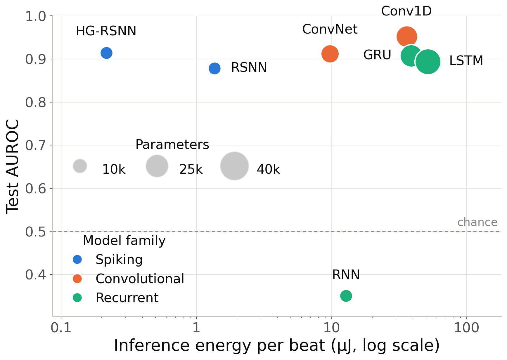

## HG-RSNN: Hierarchically Gated Spiking Neural Networks for Interpretable Arrhythmia Detection

Official PyTorch implementation of **HG-RSNN**, from the following paper:

Hierarchically Gated Spiking Neural Networks for Interpretable Arrhythmia Detection. Computing in Cardiology 2026. (link to come)\
Rahul Pemmaraju, Anshul Voleti and Aaron D. Milstein\
Rutgers University

---

<p align="center">
<picture>
  <source media="(prefers-color-scheme: dark)" srcset="assets/energy_vs_auroc_dark.png">
  
</picture>
</p>

We propose **HG-RSNN**, a recurrent spiking neural network whose learnable gates control when information flows between layers. On binary arrhythmia detection on the MIT-BIH Arrhythmia Database, it matches non-spiking baselines while using 2–4× fewer parameters and 40–240× less estimated inference energy. Its gate activity shows which parts of the ECG drive each prediction. It can also be trained with e-prop, which needs 13.5× less training memory than backpropagation through time.

## Catalog
- [x] MIT-BIH beat dataset with the de Chazal inter-patient split
- [x] HG-RSNN, its ablations and a standard RSNN, trained with BPTT
- [x] HG-RSNN trained with e-prop
- [x] Non-spiking baselines (Conv1D, ConvNet, RNN, GRU, LSTM)
- [x] Inference energy estimation for spiking and non-spiking models
- [x] Gate visualization and interpretability

## Results

Test set (de Chazal DS2, 10,616 beats). Mean ± standard deviation over five random initializations. Energy is estimated per beat.

| Model | AUROC | Parameters | Energy (nJ) |
| --- | --- | --- | --- |
| RNN | 0.351 ± 0.008 | 10,305 | 12,798 |
| GRU | 0.908 ± 0.012 | 30,849 | 38,790 |
| LSTM | 0.894 ± 0.009 | 41,121 | 51,548 |
| Conv1D | 0.952 ± 0.006 | 28,929 | 35,929 |
| ConvNet | 0.912 ± 0.002 | 20,673 | 9,714 |
| RSNN | 0.878 ± 0.024 | 10,304 | 1,363 ± 77 |
| HG-RSNN − F | 0.785 ± 0.170 | 10,400 | 1,002 ± 390 |
| HG-RSNN − S | 0.913 ± 0.005 | 10,400 | 275 ± 25 |
| **HG-RSNN** | **0.914 ± 0.003** | **10,400** | **216 ± 5** |
| HG-RSNN (e-prop) | 0.874 ± 0.019 | 10,400 | 285 ± 18 |

HG-RSNN − F never resets layer state, and HG-RSNN − S passes input between layers at every timestep. Sensitivity and specificity (Table 1), training memory and the gate analysis are in [REPRODUCE.md](REPRODUCE.md#results).

## Installation
```
git clone https://github.com/rahulpemmaraju/arrhythmia_detection.git
cd arrhythmia_detection
conda create --name hgrsnn python=3.12.0 && conda activate hgrsnn
pip install -r requirements.txt
```

Hyperparameter search also needs [nested](https://github.com/neurosutras/nested) on your `PYTHONPATH`.

## Data
Download the [MIT-BIH Arrhythmia Database](https://physionet.org/content/mitdb/1.0.0/) and cut it into beats:
```
wget -r -N -c -np https://physionet.org/files/mitdb/1.0.0/
python create_beat_dataset.py --raw_data_folder=physionet.org/files/mitdb/1.0.0/ \
  --processed_data_folder=beats --window_length=1 --pre_window=0.5 --post_window=0 --downsample_factor=2
```

## Training and evaluation
Train and evaluate HG-RSNN over five seeds with the optimized hyperparameters:
```
python main.py --config_file=hgrsnn_large_config.yaml --model_name=hgrsnn \
  --data_dir=beats --output_dir=results --num_seeds=5 --train --use_best_model
```

Leave out `--train` to evaluate existing weights. Metrics are written to `results/model_results/metrics/hgrsnn_fixed_sensitivity.csv`.

Then estimate its inference energy:
```
python evaluate_energy.py --config_file=hgrsnn_large_config.yaml --model_name=hgrsnn \
  --weight_dir=results/model_weights --data_dir=beats --output_dir=energy --use_best_model
```

Everything runs on CPU. [REPRODUCE.md](REPRODUCE.md) has the commands for every table and figure in the paper: the ablations, e-prop, the baselines, training memory, the gate analysis and the hyperparameter search.

## Acknowledgement
This repository uses [snnTorch](https://github.com/jeshraghian/snntorch), [NeuroKit2](https://github.com/neuropsychology/NeuroKit), [WFDB](https://github.com/MIT-LCP/wfdb-python) and [nested](https://github.com/neurosutras/nested).

## Citation
If you find this repository helpful, please consider citing:
```
@inproceedings{pemmaraju2026hgrsnn,
  title     = {Hierarchically Gated Spiking Neural Networks for Interpretable Arrhythmia Detection},
  author    = {Pemmaraju, Rahul and Voleti, Anshul and Milstein, Aaron D.},
  booktitle = {Computing in Cardiology},
  year      = {2026}
}
```
